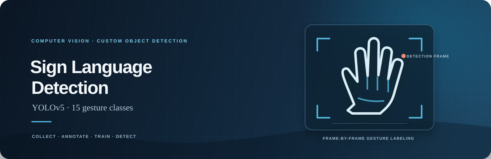
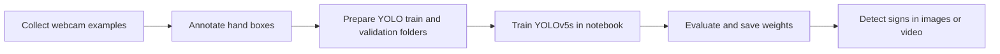
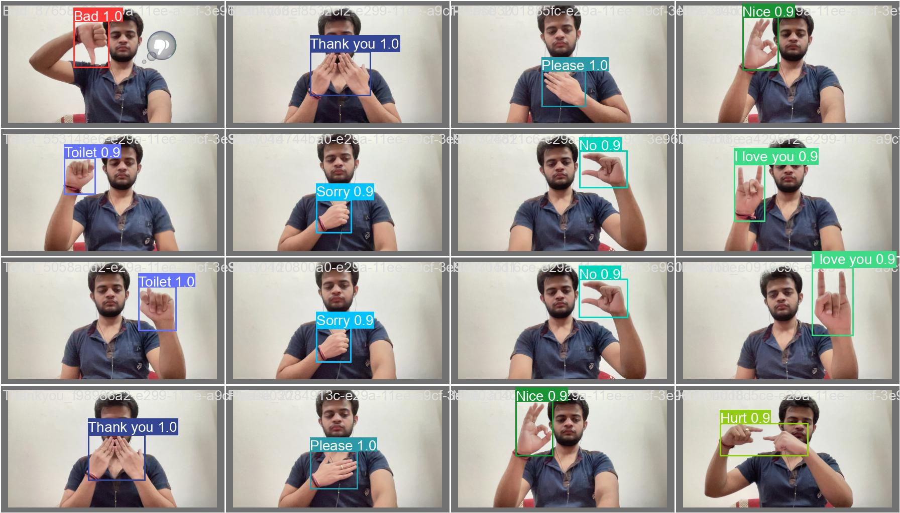

<div align="center">



<br />

[](sign-lang-detection.ipynb)
[](result/weights/best.pt)

<br />

`YOLOv5` &nbsp; · &nbsp; `CUSTOM DATASET` &nbsp; · &nbsp; `15 GESTURE CLASSES`

</div>

<br />

> **The project** &nbsp; A notebook-based computer vision pipeline for detecting a defined set of hand-sign classes in images and video frames. It includes a webcam image collector, YOLOv5 training notebook, trained weights, and sample evaluation output.

---

## ◈ Explore

<div align="center">

| &nbsp;01&nbsp; **Overview** | &nbsp;02&nbsp; **Pipeline** | &nbsp;03&nbsp; **Train** | &nbsp;04&nbsp; **Results** |
|:---:|:---:|:---:|:---:|
| [Classes](#gesture-classes) | [How it works](#pipeline) | [Get started](#train-in-google-colab) | [Model output](#sample-predictions) |

</div>

## What it does

The model detects and labels **15 predefined gesture classes** with YOLOv5. It returns object-detection boxes and class confidence scores for individual frames. This repository is a gesture detector; it does not translate continuous signing into sentences.

### Gesture classes

`Bad` · `Good` · `Goodbye` · `Hello` · `Help` · `House` · `Hurt` · `I love you` · `Nice` · `No` · `Please` · `Sorry` · `Thank you` · `Toilet` · `Yes`

## Pipeline



| File | Role |
|:--|:--|
| [`labels.csv`](labels.csv) | Class names used by the data collection notebook |
| [`data-collection.ipynb`](data-collection.ipynb) | Captures webcam images for the listed classes |
| [`data.yaml`](data.yaml) | YOLO dataset paths and the 15 class names |
| [`sign-lang-detection.ipynb`](sign-lang-detection.ipynb) | Clones YOLOv5, installs its requirements, trains the model, and runs detection on validation images |
| [`result/weights/best.pt`](result/weights/best.pt) | Best checkpoint from the included training run |
| [`result/weights/last.pt`](result/weights/last.pt) | Final checkpoint from the included training run |
| [`result/`](result/) | Training plots, metrics, label visualizations, and sample predictions |

The image dataset itself is **not included**. The collector saves images; you still need to annotate bounding boxes and arrange the images and labels in YOLO format before training. Update `train` and `val` in `data.yaml` to match your dataset paths. Each label file uses normalized coordinates: `class x_center y_center width height`.

## Sample predictions

The repository includes a validation batch rendered by YOLOv5, with predicted class labels and confidence scores:

<div align="center">



</div>

Training curves and additional evaluation plots are available in [`result/`](result/).

## Train in Google Colab

The training notebook uses Colab paths and clones the upstream YOLOv5 repository. The dataset files must be available in the Colab session at the paths configured in `data.yaml`.

1. Open [`sign-lang-detection.ipynb`](sign-lang-detection.ipynb) in Google Colab.
2. Upload `data.yaml` and your YOLO-format train/validation image and label folders. Adjust the `train` and `val` paths in `data.yaml` if needed.
3. Run the notebook from the top. It clones YOLOv5, installs the project requirements, and trains the YOLOv5s model using the notebook’s configuration (416-pixel images, batch size 16, 300 epochs).
4. Review the training curves and sample detections. The notebook saves the best and final checkpoints under `yolov5/runs/train/yolov5s_results/weights/`.

A GPU runtime is recommended for training. The repository’s `result/weights/` contains checkpoints from an existing run, so training is not required just to inspect the results.

## Run detection with the included weights

The repository does not include a standalone `run.py`. Use the `detect.py` script from the upstream YOLOv5 repository with the included checkpoint:

```bash
git clone https://github.com/ultralytics/yolov5.git
cd yolov5
pip install -r requirements.txt
python detect.py \
  --weights /path/to/Sign-Language-Detection-Using-YOLOv5/result/weights/best.pt \
  --img 416 \
  --conf 0.1 \
  --source 0
```

Replace the weight path with the location of this repository. `--source 0` uses the default webcam; use an image, video file, or image-directory path to run on saved media. YOLOv5 writes rendered detections under its `runs/detect/` directory.

## Model and evaluation

The training notebook configures a YOLOv5s model initialized from pretrained `yolov5s.pt` weights. Training settings and outputs are preserved in [`result/opt.yaml`](result/opt.yaml), [`result/hyp.yaml`](result/hyp.yaml), and [`result/results.csv`](result/results.csv). The `result/` folder also contains precision, recall, F1, and precision-recall curves, plus a confusion matrix.

## Limitations

- The training image dataset is not committed; you must provide and annotate your own data.
- The model recognizes only the 15 classes listed in `data.yaml`; it is not a general sign-language recognizer or sentence translator.
- Predictions depend on the training data and can vary with camera angle, lighting, background, distance, and signing style.
- The included notebook is written for Google Colab paths and may need path changes for local Jupyter use.
- A webcam is needed only when collecting images or selecting webcam source `0` for detection.

## Credits

The project was developed while following this [Sign Language Detection tutorial playlist](https://youtube.com/playlist?list=PLkz_y24mlSJYWpwFbU8fyaBSwihoVHiJz&si=ssh-POaD9XPm4Q8g). Model training and inference use [Ultralytics YOLOv5](https://github.com/ultralytics/yolov5).

---

<div align="center">

**Sign Language Detection** &nbsp; · &nbsp; Collect. Annotate. Train. Detect.

[Open the training notebook →](sign-lang-detection.ipynb)

</div>
